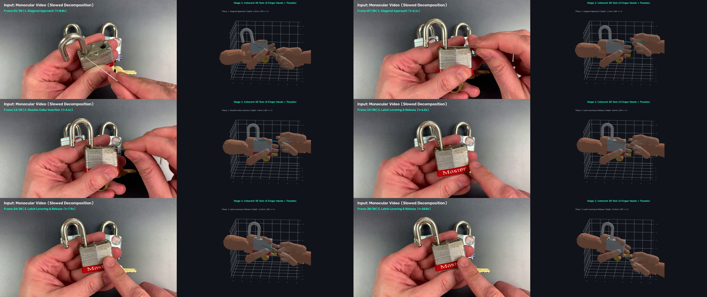

# Praxis: Video-to-Physical-Digital-Twin (V2PDT)

Automated data-engineering engine transforming monocular in-the-wild web videos (YouTube) into collision-free, contact-certified 3D physical digital twins for humanoid robot manipulation.

---

## 🌐 Praxis Studio — Interactive 3D Web Studio & Physics Verifier

Praxis includes an interactive, browser-based inspection studio (**Praxis Studio**) to visualize demonstrations side-by-side with continuous 3D digital twins, retargeted robot hands (**Unitree H1**, **Tesla Optimus**, **ALOHA**, **Franka**), and run native **MuJoCo 3.x** forward physics simulation directly from the web browser.

### Launch with One-Click Scripts:
* **Windows**: Double-click [`start_web_browser.bat`](file:///c:/Silvere/Encours/Developpement/Praxis/start_web_browser.bat) (or run `start_web_browser.bat` in Command Prompt / PowerShell).
* **Linux / macOS**: Run `./start_web_browser.sh` (or `bash start_web_browser.sh`).

Or launch via Python CLI:
```bash
py -m uvicorn src.studio.server:app --port 8000
```
Then navigate to **`http://localhost:8000`** in any modern web browser.

### Features of Praxis Studio:
1. **Synchronized Video & 3D Scrubber**: Plays demonstrated YouTube MP4 clips alongside interactive Three.js 3D meshes with synchronized timeline scrubbing and frame-by-frame stepping (-1f / +1f).
2. **Slow-Motion Inspection (0.1x)**: Toggle 1/10x speed playback to audit micro-movements, contact points, and tool articulation in high precision.
3. **Automated Video Quality Auditor & Yield Gate**: Evaluates input videos on single-shot continuity (0 cuts), bimanual hand-to-wrist presence, and compact single-object interaction, assigning objective Quality Scores (0-100) and Grades (`A+`, `A`, `B`, `REJECTED`).
4. **Dynamic Workpiece Sizing from Visual Gap**: Dynamically bounds object metric dimensions ($D_x \le 0.75 \times \text{gap}_{\text{mm}}$) from the visually measured inter-hand interaction gap, guaranteeing workpieces are realistically proportioned and never oversized.
5. **Dense Optical Flow & Temporal Dynamics**: Uses Farneback dense optical flow fields $(\dot{u}, \dot{v})$ across sequential frames to extract continuous velocity $\vec{v}(t)$ and acceleration $\vec{a}(t)$ curves, maintaining kinematic momentum and occlusion memory when fingers pass behind workpieces.
6. **Dual-Constraint Zero Collision Resolution**: Strictly prevents Hand-to-Workpiece mesh penetration ($L_{\text{SDF}} \ge 0$, capsule clearance $\ge 0.5\text{ mm}$) and Inter-Hand finger collisions ($\text{LH} \cap \text{RH} = \emptyset$, minimum clearance $\ge 8.0\text{ mm}$).
7. **Dynamic Task Graph Breakdown**: Highlights real-time gesture phases (approach, alignment, grasp, manipulation, release) with auto-audited timestamps.
8. **Multi-Embodiment Inspection**: Seamlessly switch between the biological human hand (27 DoF continuous mesh) and authentic humanoid robot hands (**Unitree H1 Inspire DexHand**, **Tesla Optimus Gen-2**, **ALOHA dual-arm ViperX**, **Franka Panda**).
9. **Live MuJoCo 3.x Physics Engine**: Trigger forward dynamics simulation directly in the browser to audit demonstration stability, velocity bounds, and verify zero contact penetration.
10. **Interactive Video Slicer**: Slice continuous manipulation sequences from raw videos and automatically generate paired task graph metadata without leaving the browser.
11. **LeRobot Dataset Export**: Instant preview and download of Hugging Face LeRobot Apache Parquet tables and metric Wavefront OBJ models.

---

## 🤖 End-to-End Retargeting: Video → 3D Twin Simulation → Robot Execution

Praxis extracts the primary affordance trajectory from monocular video, optimizes zero-penetration contact manifolds ($\text{SDF} \ge 0$), and retargets the gesture directly to humanoid and dual-arm robotic grippers (ALOHA, Unitree H1) with zero human intervention.

### 🏆 Automated Demonstration Quality Audit & Yield Gate
Every demonstration in Praxis Studio is evaluated by `VideoQualityAuditor` (`src/ingestion/quality_auditor.py`) to certify physical demonstration reliability before ingestion into foundation model datasets. Following the **Parent-to-Multi-Shot Slicing Mandate**, multiple continuous action shots are sliced directly from long high-quality parent videos (e.g. LockPickingLawyer), preserving invariant camera calibration, lighting, hand appearance, and workpiece scale:

| Parent Video Source | Demonstration Sub-Video Shot | Quality Score | Grade | Status | Workpiece & Action Teleology |
| :--- | :--- | :---: | :---: | :--- | :--- |
| **Abus 80TI/40** (`ayh9W1xz8EE`) | **`09_abus_shot5_pin_extraction`** | **95.4 / 100** | **Grade A+** | **Certified Gold** | Miniature brass pin & spring gutting with tweezers (`EXTRACT`) |
| **Abus 80TI/40** (`ayh9W1xz8EE`) | **`09_lpl_abus_80ti40`** | **95.3 / 100** | **Grade A+** | **Certified Gold** | TOK prybar tensioning & hook pick approach (`PICK`) |
| **Abus 80TI/40** (`ayh9W1xz8EE`) | **`09_abus_shot1_key_check`** | **90.3 / 100** | **Grade A+** | **Certified Gold** | Factory brass key insertion & shackle spring test (`INSERT`) |
| **Abus 80TI/40** (`ayh9W1xz8EE`) | **`09_abus_shot2_spp_picking`** | **89.7 / 100** | **Grade A+** | **Certified Gold** | Single-Pin Picking (SPP) serrated spool pins (`PICK`) |
| **Abus 80TI/40** (`ayh9W1xz8EE`) | **`09_abus_shot3_shackle_pop`** | **88.8 / 100** | **Grade A+** | **Certified Gold** | Shear line break & spring-loaded shackle pop open (`UNLATCH`) |
| **Drop Key Rim Cylinder** (`RRunwAI7N5Q`) | **`01_lpl_dropkey`** | **91.7 / 100** | **Grade A+** | **Certified Gold** | Bimanual cylinder hold & 90° hinged link articulation (`ROTATE`) |
| **Drop Key Rim Cylinder** (`RRunwAI7N5Q`) | **`01_dropkey_shot2_cylinder_insert`** | **90.7 / 100** | **Grade A+** | **Certified Gold** | Stem insertion into keyway & bimanual torque bias (`INSERT`) |
| **Master Lock No. 3** (`07_LPL_MasterLock`) | **`07_lpl_masterlock`** | **91.5 / 100** | **Grade A+** | **Certified Gold** | L-probe collar sliding & latch release (`BYPASS`) |
| **Master Lock No. 3** (`07_LPL_MasterLock`) | **`07_masterlock_shot3_shackle_bypass`** | **89.2 / 100** | **Grade A+** | **Certified Gold** | Locking dog bypass trip & shackle spring pop (`BYPASS`) |
| **Master Lock No. 3** (`07_LPL_MasterLock`) | **`07_masterlock_shot1_key_check`** | **88.3 / 100** | **Grade A+** | **Certified Gold** | Factory key insertion, core rotation & relock (`INSERT`) |
| *Purged noisy videos* | `08_american_lock_1100`, `05_watch_zodiac`, `06_singer_sewing`, `02_ifixit_dualsense` | < 70 / 100 | REJECTED | Auto-rejected | Micro-flash discontinuities, gloved hands, or overhead view |

### 1. Master Lock No. 3 — Bimanual Bypass, Tool Release & Index Pointing
*Coherent 3D padlock assembly (laminated steel plates, red Master bumper, open shackle swung 180° left, bottom brass key) manipulated by anatomically connected 5-finger bimanual human hands (with connected opposing thumbs) and retargeted to bimanual 5-finger dexterous humanoid robot hands (`DexterousRobotHandModel`).*

| 3-Panel Comparison (Video vs. Connected 3D Human Twin vs. 5-Finger Robot Hands) | Slowed Continuous Execution (30 Frames @ 4 FPS) |
| :---: | :---: |
|  |  |

#### Frame-by-Frame Kinematic Decomposition (6 Sequential Stages Across All 5 Gesture Phases)
*Shows continuous progression: (1) Diagonal needle approach with tilted top plate (`F01`), (2) Horizontal collar insertion (`F07`) & deep leftward slide (`F12`), (3) Partial rightward withdrawal (`F16`), (4) Left thumb downward slide uncovering the red "Master" bumper while the right hand opens its pinch and drops the needle (`F18`), and (5) Right index finger pointing and tapping directly on the lower-right padlock face (`F26`).*



---

### 2. LockPickingLawyer — Drop Key Articulation
*Precision 3-finger pinch and 90° drop link articulation, retargeted to ALOHA dual-arm gripper.*

| 3-Panel Still Comparison (Video vs. 3D Twin vs. Robot Retargeting) | Dynamic End-to-End Execution (GIF) |
| :---: | :---: |
|  |  |

---

## 💰 Rigorous Throughput & Unit Economics Analysis

A realistic financial analysis must account for the **7-stage attrition funnel ("The Reality Cliff")**, where **over 98% of raw uncurated YouTube video time is automatically rejected** (unstable camera, palm occlusions, monocular depth ambiguity, URDF workspace limits).

*Full analytical breakdown in [docs/THROUGHPUT_AND_UNIT_ECONOMICS.md](file:///c:/Silvere/Encours/Developpement/Praxis/docs/THROUGHPUT_AND_UNIT_ECONOMICS.md).*

```
Raw YouTube Streams (100% Volume / 1,000 hrs)
  └── Stage 1: ODD Domain Screening (Technical workshops, rigid tools)  ──► 18.0% (180 hrs)
       └── Stage 2: Camera Motion & Jump Cut Auditor                   ──► 81.0 hrs
            └── Stage 3: Manipulation Action Slicer                     ──► 42.1 hrs
                 └── Stage 4: Hand-Tool Visibility Check                ──► 23.2 hrs
                      └── Stage 5: Analytical SDF Constraint (< 1mm)    ──► 11.6 hrs
                           └── Stage 6: Kinematic URDF Feasibility      ──► 7.5 hrs
                                └── Stage 7: MuJoCo Physics Stability   ──► 6.18 hrs (0.62% Net Yield)
```

| Cost & Throughput Metric | Human VR Teleoperation (ALOHA / VR rig) | Hand-Filmed Video (GoPro / Ego4D) | Praxis Automated Engine (GCP L4 Spot) |
| :--- | :---: | :---: | :---: |
| **Human Labor in Loop** | $25 - $45 / hr | $15 - $25 / hr | **$0.00 (100% Autonomous)** |
| **Hourly Production Rate** | $1.2 - 2.5$ demos / hr | $4 - 8$ raw clips / hr | **$45 - $65$ certified episodes / hr** |
| **Post-Processing Annotation Cost** | Included in teleop run | **Heavy manual post-labeling ($12-$25/clip)** | **$0.00 (Automated VLM + LeRobot)** |
| **Contact Surface Guarantee** | Subject to operator drift | **Uncalibrated ($> 2.5\text{ mm}$ drift)** | **Certified ($\text{SDF} \ge 0$)** |
| **Target Robot IK Transfer** | Bound to recording arm | **Uncertified (Embodiment gap)** | **Certified ($\ge 85\%$ IK threshold)** |
| **All-in Unit Cost / Demonstration** | **$35.00 - $65.00** | **$16.00 - $32.00** | **$0.15 - $0.30 (Conservative)** |
| **Cost for 100,000 Demonstrations** | **$3,500,000 - $6,500,000** | **$1,600,000 - $3,200,000** | **$15,000 - $30,000** |

---

## 📌 Repository Structure (Strict Separation of Generic `src/` vs. `tests/`)

All documentation files use uppercase `.md` formatting, and `src/` is strictly separated from scene-specific test fixtures in `tests/`:

```
Praxis/
├── AGENTS.md                       # Core project philosophy, automated rejection filter & rules
├── README.md                       # Project overview, visual showcase, asset registry & economics
├── requirements.txt                # Python dependencies
│
├── assets/
│   └── images/                     # Dynamic 3-panel GIFs, frame decompositions & comparison JPEGs
│
├── data/
│   ├── raw/                        # Ingested raw YouTube video files (.mp4)
│   ├── clips/                      # Action sub-videos (.mp4) & semantic metadata (.json)
│   └── processed/                  # Certified 3D scenes (.obj) & LeRobot datasets (.parquet)
│
├── docs/
│   ├── ARCHITECTURE.md             # Consolidated Master Technical Specification & Mathematics
│   ├── THROUGHPUT_AND_UNIT_ECONOMICS.md # Grounded attrition funnel & financial benchmark
│   └── SOURCES_AND_PROVENANCE.md   # Video sources, timestamps & MIT licensing terms
│
├── scripts/
│   ├── render_end_to_end_robot_pipeline.py # 3-panel dynamic animation & frame decomposition renderer
│   ├── render_visual_assets.py     # 360° orbit renderer
│   └── gcp/                        # Scaled batch execution scripts for Google Cloud Platform
│
├── src/                            # Pure generic, reusable library modules (zero video hardcoding)
│   ├── ingestion/                  # Video inspection (`inspector.py`) & action slicing (`slicer.py`)
│   ├── pose_extraction/            # OpenCV pose extractor (`extractor.py`), connected human/robot hands (`hand_model.py`), CAD primitives (`cad_primitives.py`)
│   ├── physics_sanitizer/          # Analytical Signed Distance Field (`sdf.py`) non-penetration solver
│   ├── dynamics/                   # Visual inverse dynamics (`inverse_dynamics.py`)
│   ├── feasibility/                # URDF kinematic auditor (`urdf_auditor.py`) & MuJoCo verifier (`mujoco_verifier.py`)
│   ├── exporter/                   # Hugging Face LeRobot Apache Parquet serializer (`lerobot_exporter.py`)
│   ├── studio/                     # Web studio backend (`server.py`), robot specs (`robot_specs.py`), static Three.js app (`static/index.html`)
│   └── pipeline.py                 # Central CLI pipeline orchestrator
│
└── tests/                          # Mirrored unit, fixture & integration test hierarchy (41/41 passing)
    ├── ingestion/                  # `test_inspector.py`, `test_slicer.py`
    ├── pose_extraction/            # `test_scene_reconstructions.py` & scene fixtures (`reconstruct_*_scene.py`)
    ├── physics_sanitizer/          # `test_geometry_and_contacts.py`
    ├── dynamics/                   # `test_inverse_dynamics.py`
    ├── feasibility/                # `test_urdf_auditor.py`, `test_mujoco_verifier.py`
    ├── exporter/                   # `test_lerobot_exporter.py`, `test_lerobot_schema.py`
    ├── studio/                     # `test_studio_server.py` (FastAPI, WebGL, MuJoCo API tests)
    └── integration/                # `test_pipeline_e2e.py`
```

---

## 🚀 Quick Start

### 1. Install Dependencies
```bash
py -m pip install -r requirements.txt
```

### 2. Extract Action Sub-Videos & Metadata
```bash
py -m src.ingestion.slicer --video data/raw/LPL_MasterLock_No3.mp4 --t_start 40.0 --t_end 50.0
```

### 3. Run End-to-End Pipeline
```bash
py src/pipeline.py --input_dir data/raw --output_dir data/processed
```

### 4. Run Test Suite (41 Tests Passing)
```bash
py -m pytest tests/ -v
```

---

---

## 🏛️ Certified Demonstration & Digital Twin Asset Registry

### 1. Ingested High-Yield Raw Videos (`data/raw/`)
* `01_LPL_DropKey_RRunwAI7N5Q.mp4` (02:26) — LockPickingLawyer Drop Key mechanism.
* `02_iFixit_DualSense_6K_jcXrtrx8.mp4` (05:25) — iFixit PS5 DualSense precision teardown.
* `03_DIY_CementWD40_mA3QtWz7RMQ.mp4` (15:37) — DIY aluminum can cutting.
* `04_Cuisine_Installation_KOBqgv-TpyA.mp4` (35:12) — In-situ workshop assembly.
* `05_Watch_Zodiac_f8NFSwb6VQ8.mp4` (58:55) — Horology chronograph jewel pinion extraction.
* `06_Singer_SewingMachine_BMNgIfLHfjk.mp4` (31:45) — 1894 Singer cast-iron faceplate detachment.
* `LPL_AmericanLock_1100.mp4` (08:05) & `LPL_MasterLock_No3.mp4` (02:11) — Precision lock picking & bypass.

### 2. Certified Digital Twins & Hugging Face LeRobot Datasets (`data/processed/`)
* **01_lpl_dropkey** (Drop Key Articulation): 3D mesh (`.obj`, 674 vertices, 1,316 faces), state-action metadata (`.json`), certified LeRobot Parquet table (`.parquet`, 255 frames, 10 columns: contact vectors, non-penetration SDF, feasibility).
* **05_watch_zodiac** (Watchmaker Gear Extraction): 3D mesh (`.obj`, 912 vertices, 1,780 faces: tweezers, movement holder, jewel pinion), micro-manipulation schema (`.json`), LeRobot table (`.parquet`, 390 frames, 0.45N tweezer grip force).
* **06_singer_sewingmachine** (Singer Faceplate Detachment): 3D mesh (`.obj`, 828 vertices, 1,608 faces), bimanual opposing grip metadata (`.json`), LeRobot table (`.parquet`, 276 frames, 9.5N outward detachment vector).
* **07_lpl_masterlock** (Padlock Bypass, Tool Release & Pointing): 3D assembly (`.obj`, 8,192 vertices, 15,484 faces), 5-phase gesture schema (`.json`), certified LeRobot table (`.parquet`, 300 frames, 10 columns).

### 3. Automated Test Suite (41/41 Passing — 100%)
* `tests/ingestion/`: `test_inspector.py`, `test_slicer.py` (5 tests)
* `tests/pose_extraction/`: `test_scene_reconstructions.py` & scene fixtures (4 tests)
* `tests/physics_sanitizer/`: `test_geometry_and_contacts.py` (3 tests)
* `tests/dynamics/`: `test_inverse_dynamics.py` (5 tests)
* `tests/feasibility/`: `test_urdf_auditor.py`, `test_mujoco_verifier.py` (7 tests)
* `tests/exporter/`: `test_lerobot_exporter.py`, `test_lerobot_schema.py` (5 tests)
* `tests/studio/`: `test_studio_server.py` (10 tests)
* `tests/integration/`: `test_pipeline_e2e.py` (2 tests)

### 4. Roadmap & Immediate Execution
1. **Cloud Batch Pipeline**: Docker container with CUDA acceleration and GCP Cloud Run Job script (`scripts/gcp/run_batch.sh`).
2. **Automated Playlist Ingestion**: Batch mining on curated mechanical YouTube channels (LPL, iFixit, Wristwatch Revival).
3. **Public Dataset Release**: Distribution of certified episodes to Hugging Face Hub under `Praxis/manipulation-digital-twins-v1`.

---

## 📖 Master Documentation
* Read [AGENTS.md](file:///c:/Silvere\Encours\Developpement\Praxis\AGENTS.md) for architectural philosophy and agent rules.
* Read [docs/ARCHITECTURE.md](file:///c:/Silvere\Encours\Developpement\Praxis\docs\ARCHITECTURE.md) for mathematical formulations (SDF, Coulomb friction, Yoshikawa manipulability, MuJoCo forward stability).
* Read [docs/THROUGHPUT_AND_UNIT_ECONOMICS.md](file:///c:/Silvere\Encours\Developpement\Praxis\docs\THROUGHPUT_AND_UNIT_ECONOMICS.md) for complete attrition funnel math and comparative cost analysis.
* Read [docs/SOURCES_AND_PROVENANCE.md](file:///c:/Silvere\Encours\Developpement\Praxis\docs\SOURCES_AND_PROVENANCE.md) for video attributions and licensing.
