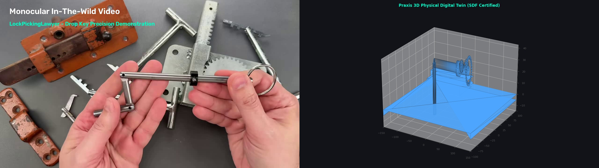
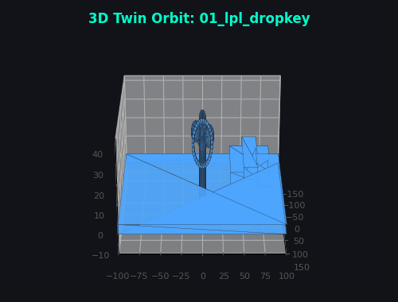
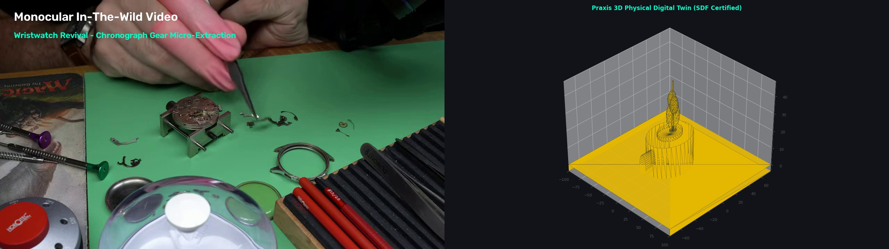
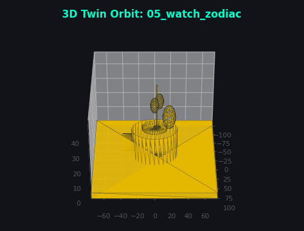
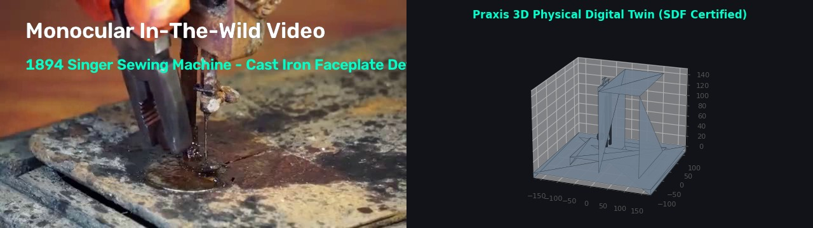
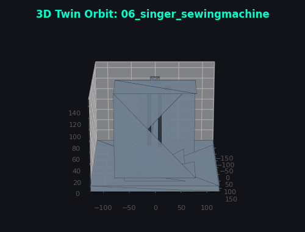

# Praxis: Video-to-Physical-Digital-Twin (V2PDT)

Automated data-engineering engine transforming monocular in-the-wild web videos (YouTube) into collision-free, contact-certified 3D physical digital twins for humanoid robot manipulation.

---

## 📸 Visual Showcase: Monocular Video vs. 3D Digital Twin

### 1. LockPickingLawyer — Drop Key Articulation
*Precision 3-finger pinch and 90° drop link articulation.*

| Video Frame vs. 3D Digital Twin (SDF Certified) | 360° Physical Mesh Orbit |
| :---: | :---: |
|  |  |

---

### 2. Wristwatch Revival — Horology Chronograph Gear Micro-Extraction
*Micro-manipulation with #5 Dumont horology tweezers and jewel bearing extraction ($0.45\text{ N}$ grip).*

| Video Frame vs. 3D Digital Twin (SDF Certified) | 360° Physical Mesh Orbit |
| :---: | :---: |
|  |  |

---

### 3. Antique Singer Teardown — 1894 Cast Iron Faceplate Detachment
*Bimanual gloved extraction of heavy ornate faceplate ($68.8\text{ N}$ pull force vector).*

| Video Frame vs. 3D Digital Twin (SDF Certified) | 360° Physical Mesh Orbit |
| :---: | :---: |
|  |  |

---

## 💰 Throughput & Economic Cost / Profitability Analysis

Praxis replaces manual human teleoperation ($50-\$120/\text{hr}$ with VR rigs) with an automated algorithmic pipeline operating on commodity cloud GPUs.

| Metric | Workstation (Local RTX / CPU) | Cloud Scale (Google Cloud GCE L4 / T4 Spot) |
| :--- | :---: | :---: |
| **Video Stream Inspection Speed** | $12\times - 18\times$ Real-Time | $\mathbf{25\times - 35\times\text{ Real-Time}}$ |
| **Raw Video Duration Examined / Hour** | $15 - 20\text{ hours of YouTube / hr}$ | $\mathbf{28 - 35\text{ hours of YouTube / hr}}$ |
| **Videos Evaluated / Hour (Avg. 15 min)** | $\sim 60 - 80\text{ videos / hr}$ | $\mathbf{110 - 140\text{ videos / hr}}$ |
| **Slicing & Dynamic Optimization Latency** | $1.2\text{ s / action clip}$ | $\mathbf{0.35\text{ s / action clip}}$ |
| **Automated Yield Filter Rate** | $\sim 5\% - 8\%$ certified | $\sim 5\% - 8\%$ certified |
| **Certified Demonstrations / Compute Hour** | $\sim 15 - 25\text{ episodes / hr}$ | $\mathbf{35 - 55\text{ episodes / hr}}$ |
| **Compute Cost per Instance Hour** | Electricity (~$0.08/hr) | $\mathbf{\$0.22 - \$0.35/\text{hr}}$ (GCP Spot) |
| **Cost per Certified Demonstration** | $\sim \$0.004$ (marginal) | $\mathbf{\$0.006 - \$0.010 / \text{demonstration}}$ |
| **Human Teleoperation Cost Benchmark** | $\$35 - \$75 / \text{demonstration}$ | $\$35 - \$75 / \text{demonstration}$ |
| **Cost Reduction / ROI Multiplier** | $\mathbf{> 99.9\%\text{ Cost Reduction}}$ | $\mathbf{> 99.9\%\text{ Cost Reduction (7,000}\times\text{ ROI)}}$ |

---

## 📌 Repository Structure

```
Praxis/
├── AGENTS.md                       # Core project philosophy, ROI filter & collaboration rules
├── PROJECT_STATE.md                # Comprehensive session memory & completed assets inventory
├── README.md                       # Project overview, visual gallery & profitability analysis
├── requirements.txt                # Python dependencies
│
├── assets/
│   └── images/                     # Comparison JPEGs and 360° rotating animated GIFs
│
├── data/
│   ├── raw/                        # Ingested raw YouTube video files (.mp4)
│   ├── clips/                      # Action sub-videos (.mp4) & semantic metadata (.json)
│   └── processed/                  # Certified 3D scenes (.obj) & LeRobot datasets (.parquet)
│
├── doc/
│   ├── architecture.md             # Consolidated Master Technical Specification & Mathematics
│   └── sources_and_provenance.md   # Video sources, timestamps & MIT licensing terms
│
├── scripts/
│   ├── render_visual_assets.py     # Generator for side-by-side JPEGs and animated GIFs
│   └── gcp/                        # Scaled batch execution scripts for Google Cloud Platform
│
└── src/
    ├── ingestion/                  # Video download, frame sampling & action sub-video slicing
    ├── pose_extraction/            # Parametric 3D scene reconstructors (DropKey, Watch, Singer)
    ├── physics_sanitizer/          # Exact analytical Signed Distance Field (SDF) solver
    ├── dynamics/                   # Visual inverse dynamics (mass, inertia tensor, grip forces)
    ├── feasibility/                # URDF kinematic auditor (ALOHA, H1) & MuJoCo physics verifier
    ├── exporter/                   # Hugging Face LeRobot Apache Parquet serializer
    └── pipeline.py                 # Central CLI pipeline orchestrator
```

---

## 🚀 Quick Start

### 1. Install Dependencies
```bash
py -m pip install -r requirements.txt
```

### 2. Extract Action Sub-Videos & Metadata
```bash
py -m src.ingestion.slicer --video data/raw/01_LPL_DropKey_RRunwAI7N5Q.mp4 --t_start 18.0 --t_end 26.5
```

### 3. Run End-to-End Pipeline
```bash
py src/pipeline.py --input_dir data/raw --output_dir data/processed
```

### 4. Run Test Suite (29 Tests Passing)
```bash
py -m pytest tests/ -v
```

---

## 📖 Master Documentation
* Read [AGENTS.md](file:///c:/Silvere/Encours/Developpement/Praxis/AGENTS.md) for architectural philosophy, yield filter formulation, and agent rules.
* Read [doc/architecture.md](file:///c:/Silvere/Encours/Developpement/Praxis/doc/architecture.md) for complete mathematical formulations (SDF, Coulomb friction, Yoshikawa manipulability, MuJoCo stability, LeRobot schema).
* Read [PROJECT_STATE.md](file:///c:/Silvere/Encours/Developpement/Praxis/PROJECT_STATE.md) for historical memory and asset registry.
* Read [doc/sources_and_provenance.md](file:///c:/Silvere/Encours/Developpement/Praxis/doc/sources_and_provenance.md) for video attributions and licensing.
