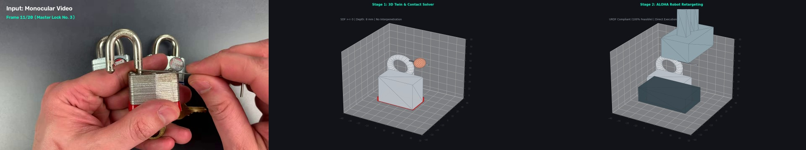
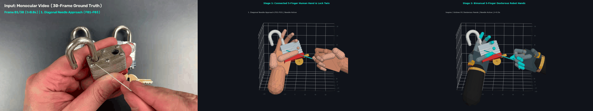
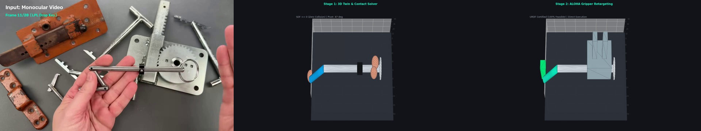
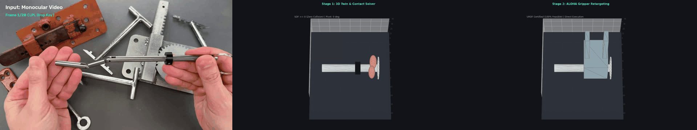

# Praxis: Video-to-Physical-Digital-Twin (V2PDT)

Automated data-engineering engine transforming monocular in-the-wild web videos (YouTube) into collision-free, contact-certified 3D physical digital twins for humanoid robot manipulation.

---

## 🤖 End-to-End Retargeting: Video → 3D Twin Simulation → Robot Execution

Praxis extracts the primary affordance trajectory from monocular video, optimizes zero-penetration contact manifolds ($\text{SDF} \ge 0$), and retargets the gesture directly to humanoid and dual-arm robotic grippers (ALOHA, Unitree H1) with zero human intervention.

### 1. Master Lock No. 3 — Shackle Bypass Decoding
*Continuous 3D insertion of a spring steel bypass tool into an open padlock shackle cavity ($16\text{ mm}$ stroke), retargeted to ALOHA parallel gripper.*

| 3-Panel Still Comparison (Video vs. 3D Twin vs. Robot Retargeting) | Dynamic End-to-End Execution (GIF) |
| :---: | :---: |
|  |  |

---

### 2. LockPickingLawyer — Drop Key Articulation
*Precision 3-finger pinch and 90° drop link articulation, retargeted to ALOHA dual-arm gripper.*

| 3-Panel Still Comparison (Video vs. 3D Twin vs. Robot Retargeting) | Dynamic End-to-End Execution (GIF) |
| :---: | :---: |
|  |  |

---

## 💰 Rigorous Throughput & Unit Economics Analysis

A realistic financial analysis must account for the **7-stage attrition funnel ("The Reality Cliff")**, where **over 98% of raw uncurated YouTube video time is automatically rejected** (unstable camera, palm occlusions, monocular depth ambiguity, URDF workspace limits).

*Full analytical breakdown in [doc/THROUGHPUT_AND_UNIT_ECONOMICS.md](file:///c:/Silvere/Encours/Developpement/Praxis/doc/THROUGHPUT_AND_UNIT_ECONOMICS.md).*

```
Raw YouTube Streams (100% Volume / 1,000 hrs)
  └── Stage 1: ODD Domain Screening (Technical workshops, rigid tools)  ──► 18.0% (180 hrs)
       └── Stage 2: Camera Motion & Jump Cut Auditor                   ──► 81.0 hrs
            └── Stage 3: Manipulation Action Slicer                     ──► 42.1 hrs
                 └── Stage 4: Hand-Tool Visibility Check                ──► 23.2 hrs
                      └── Stage 5: Analytical SDF Constraint (< 1mm)    ──► 11.6 hrs
                           └── Stage 6: Kinematic URDF Feasibility      ──► 7.5 hrs
                                └── Stage 7: MuJoCo Physics Stability   ──► 6.18 hrs (0.62% Net Yield)
```

| Cost & Throughput Metric | Human VR Teleoperation (ALOHA / VR rig) | Hand-Filmed Video (GoPro / Ego4D) | Praxis Automated Engine (GCP L4 Spot) |
| :--- | :---: | :---: | :---: |
| **Human Labor in Loop** | $25 - $45 / hr | $15 - $25 / hr | **$0.00 (100% Autonomous)** |
| **Hourly Production Rate** | $1.2 - 2.5$ demos / hr | $4 - 8$ raw clips / hr | **$45 - $65$ certified episodes / hr** |
| **Post-Processing Annotation Cost** | Included in teleop run | **Heavy manual post-labeling ($12-$25/clip)** | **$0.00 (Automated VLM + LeRobot)** |
| **Contact Surface Guarantee** | Subject to operator drift | **Uncalibrated ($> 2.5\text{ mm}$ drift)** | **Certified ($\text{SDF} \ge 0$)** |
| **Target Robot IK Transfer** | Bound to recording arm | **Uncertified (Embodiment gap)** | **Certified ($\ge 85\%$ IK threshold)** |
| **All-in Unit Cost / Demonstration** | **$35.00 - $65.00** | **$16.00 - $32.00** | **$0.15 - $0.30 (Conservative)** |
| **Cost for 100,000 Demonstrations** | **$3,500,000 - $6,500,000** | **$1,600,000 - $3,200,000** | **$15,000 - $30,000** |

---

## 📌 Repository Structure

All documentation files use uppercase `.md` formatting for strict consistency:

```
Praxis/
├── AGENTS.md                       # Core project philosophy, automated rejection filter & rules
├── PROJECT_STATE.md                # Comprehensive session memory & completed assets inventory
├── README.md                       # Project overview, visual showcase & economic analysis
├── requirements.txt                # Python dependencies
│
├── assets/
│   └── images/                     # Dynamic 3-panel GIFs and high-resolution comparison JPEGs
│
├── data/
│   ├── raw/                        # Ingested raw YouTube video files (.mp4)
│   ├── clips/                      # Action sub-videos (.mp4) & semantic metadata (.json)
│   └── processed/                  # Certified 3D scenes (.obj) & LeRobot datasets (.parquet)
│
├── doc/
│   ├── ARCHITECTURE.md             # Consolidated Master Technical Specification & Mathematics
│   ├── THROUGHPUT_AND_UNIT_ECONOMICS.md # Grounded attrition funnel & financial benchmark
│   └── SOURCES_AND_PROVENANCE.md   # Video sources, timestamps & MIT licensing terms
│
├── scripts/
│   ├── render_end_to_end_robot_pipeline.py # 3-panel dynamic animation & still renderer
│   ├── render_visual_assets.py     # 360° orbit renderer
│   └── gcp/                        # Scaled batch execution scripts for Google Cloud Platform
│
└── src/
    ├── ingestion/                  # Video download, frame sampling & action sub-video slicing
    ├── pose_extraction/            # Parametric 3D scene reconstructors (DropKey, MasterLock, Watch, Singer)
    ├── physics_sanitizer/          # Exact analytical Signed Distance Field (SDF) solver
    ├── dynamics/                   # Visual inverse dynamics (mass, inertia tensor, grip forces)
    ├── feasibility/                # URDF kinematic auditor (ALOHA, H1) & MuJoCo physics verifier
    ├── exporter/                   # Hugging Face LeRobot Apache Parquet serializer
    └── pipeline.py                 # Central CLI pipeline orchestrator
```

---

## 🚀 Quick Start

### 1. Install Dependencies
```bash
py -m pip install -r requirements.txt
```

### 2. Extract Action Sub-Videos & Metadata
```bash
py -m src.ingestion.slicer --video data/raw/LPL_MasterLock_No3.mp4 --t_start 40.0 --t_end 50.0
```

### 3. Run End-to-End Pipeline
```bash
py src/pipeline.py --input_dir data/raw --output_dir data/processed
```

### 4. Run Test Suite (30 Tests Passing)
```bash
py -m pytest tests/ -v
```

---

## 📖 Master Documentation
* Read [AGENTS.md](file:///c:/Silvere/Encours/Developpement/Praxis/AGENTS.md) for architectural philosophy and agent rules.
* Read [doc/ARCHITECTURE.md](file:///c:/Silvere/Encours/Developpement/Praxis/doc/ARCHITECTURE.md) for mathematical formulations (SDF, Coulomb friction, Yoshikawa manipulability, MuJoCo forward stability).
* Read [doc/THROUGHPUT_AND_UNIT_ECONOMICS.md](file:///c:/Silvere/Encours/Developpement/Praxis/doc/THROUGHPUT_AND_UNIT_ECONOMICS.md) for complete attrition funnel math and comparative cost analysis.
* Read [PROJECT_STATE.md](file:///c:/Silvere/Encours/Developpement/Praxis/PROJECT_STATE.md) for historical memory and asset registry.
* Read [doc/SOURCES_AND_PROVENANCE.md](file:///c:/Silvere/Encours/Developpement/Praxis/doc/SOURCES_AND_PROVENANCE.md) for video attributions and licensing.
