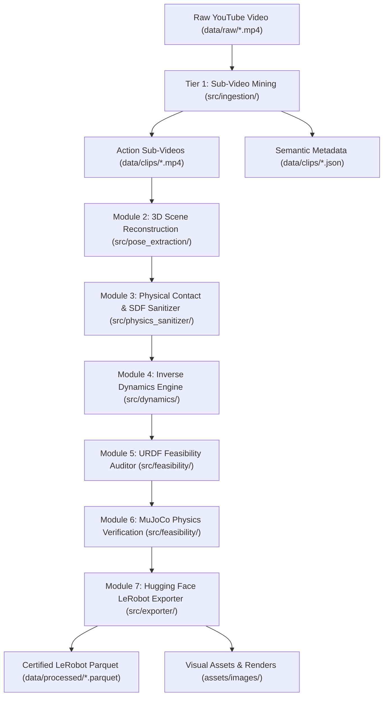

# Praxis System Architecture & Technical Specification

> **Praxis: Video-to-Physical-Digital-Twin (V2PDT) for Humanoid Robotics**  
> Automated engine transforming monocular in-the-wild web video (YouTube) into collision-free, contact-certified 3D physical digital twins for humanoid robot manipulation.

---

## 1. Executive Vision & Problem Formulation

### 1.1 The Humanoid Robotics Demonstration Bottleneck
Training dexterous humanoid manipulation policies requires millions of diverse, high-quality demonstration trajectories. Teleoperation (humans wearing VR headsets or body rigs) cannot scale to internet-scale volume. Conversely, learning directly from raw YouTube video pixels causes three catastrophic failure modes:
1. **The Kinematic Illusion**: Monocular 3D tracking hallucinates finger penetration through rigid tool handles or floating meshes without contact.
2. **Missing Dynamics**: RGB video contains zero tactile feedback, motor torques, or contact friction.
3. **The Embodiment Gap**: Human hands (27 DoF, compliant skin) do not match rigid 3-to-6 DoF robot grippers.

### 1.2 Boundary Principles & Scope
* **Workpiece Primacy Principle**: When extracting manipulation, **the tool and workpiece 3D trajectory is primary**; human finger joint positions are secondary proxies. Tool affordance trajectories are robot-agnostic (transferring identically to ALOHA, Unitree H1, or Franka Panda).
* **The Automated Yield Filter ($N \to \infty$)**: YouTube is an infinite reservoir. A 5% yield is completely acceptable, provided filtering is 100% automated with zero human review required:
  $$\text{Filter Score} = \text{CameraStability} \times \text{PenetrationConstraint} \times \text{URDFFeasibility} \times \text{MuJoCoStability}$$
* **Operational Design Domain (ODD)**:
  - **In-Scope (V1)**: Rigid standardized mechanical components (tools, keys, cylinders, fasteners, electronics assemblies, precision gears, machine plates).
  - **Out-of-Scope (V1)**: Deformable non-rigid topological mutations (fluids, cloth folding, food cutting).

---

## 2. End-to-End Pipeline Workflow

---

## 3. Subsystem Technical Formulations

### Module 1: Action Slicing & Semantic Metadata (`src/ingestion/`)
* Splits raw continuous streams into autonomous manipulation sub-videos ($5-20\text{ s}$).
* Generates structured task graph metadata (`t_start`, `t_end`, action verbs, tool ID, workpiece ID, camera stability).

### Module 2: Parametric 3D Digital Twin Recovery (`src/pose_extraction/`)
* Fits metric CAD primitives (cylinders, boxes, annuli) to tools and workpieces.
* Establishes metric scale grounding using standardized dimensions of known rigid objects.

### Module 3: Analytical SDF Collision Arbitrator (`src/physics_sanitizer/`)
* Enforces exact non-penetration penalty $\text{SDF}(p) \ge 0$ for rigid primitives:
  - **Cylinder**: $d(p) = \max(r_{\text{dist}}, 0) + \min(\max(r_{\text{dist}}, z_{\text{dist}}), 0)$
  - **Box**: $d(p) = \|\max(|p| - h, 0)\| + \min(\max(|p| - h), 0)$
* Snaps fingertip contact points to outer affordance surfaces, eliminating mesh penetration artifacts.

### Module 4: Visual Inverse Dynamics Engine (`src/dynamics/`)
* **Mass Estimation**: $m = V \times \rho_{\text{material}}$ using calibrated physical density tables (brass: $8.5\text{ g/cm}^3$, steel: $7.9\text{ g/cm}^3$, cast iron: $7.2\text{ g/cm}^3$).
* **Principal Inertia Tensor**: Computes analytical $I_{3 \times 3} \in \mathbb{R}^{3 \times 3}$ at center of mass.
* **Coulomb Friction Grip Force**:
  $$F_N \ge \frac{m \|\ddot{x}(t) - g\|}{\mu \cdot n_{\text{contacts}}} \times \text{safety\_margin}$$

### Module 5: Kinematic Feasibility Auditor (`src/feasibility/`)
* Solves numerical IK and screens target trajectories against robot URDF limits (**ALOHA ViperX**, **Unitree H1**, **Franka Panda**).
* Rejection criteria:
  - Workspace reach envelope: $r \in [r_{\min}, r_{\max}]$
  - Joint position limits: $q_i \in [q_{\min}, q_{\max}]$
  - Joint velocity limits: $\dot{q}_i \le \dot{q}_{\max}$
  - Yoshikawa Manipulability measure: $w = \sqrt{\det(J J^T)} \ge 10^{-4}$ (detects singularities)
* Automated gatekeeper threshold: $\ge 85\%$ compliance.

### Module 6: MuJoCo Simulation Verification (`src/feasibility/mujoco_verifier.py`)
* Synthesizes native MJCF XML environments.
* Steps forward physics dynamics under gravity to certify dynamical stability, contact compliance, and absence of numerical explosion ($\max \|v\| < 10\text{ m/s}$).

### Module 7: Hugging Face LeRobot Parquet Serialization (`src/exporter/`)
* Standardizes digital twin demonstrations into Apache Parquet / Arrow schemas matching the official Hugging Face LeRobot standard:
  - `episode_index`: int64
  - `frame_index`: int64
  - `timestamp`: float32
  - `observation.state`: float32 list (7-DoF or 14-DoF bi-manual pose $[x, y, z, q_x, q_y, q_z, q_w]$)
  - `action`: float32 list (delta pose + gripper command)
  - `physics.contact_force_n`: float32
  - `physics.sdf_distance_mm`: float32
  - `feasibility_score`: float32
  - `task_description`: string

---

## 4. Development Status & Roadmap

| Phase | Milestone Description | Status |
| :--- | :--- | :---: |
| **Phase 1** | Foundation, raw video ingestion, sub-video slicing, semantic metadata | **Completed (100%)** |
| **Phase 2** | Metric 3D digital twins, visual asset generator, side-by-side renders | **Completed (100%)** |
| **Phase 3** | Analytical SDF solver, force-closure contacts, inverse dynamics engine | **Completed (100%)** |
| **Phase 4** | URDF kinematic auditor, automated $\ge 85\%$ filter, MuJoCo stability verification | **Completed (100%)** |
| **Phase 5** | Scaled cloud execution (Google Cloud Run / GCE L4 GPUs) & Hugging Face release | **Next (Scheduled)** |
