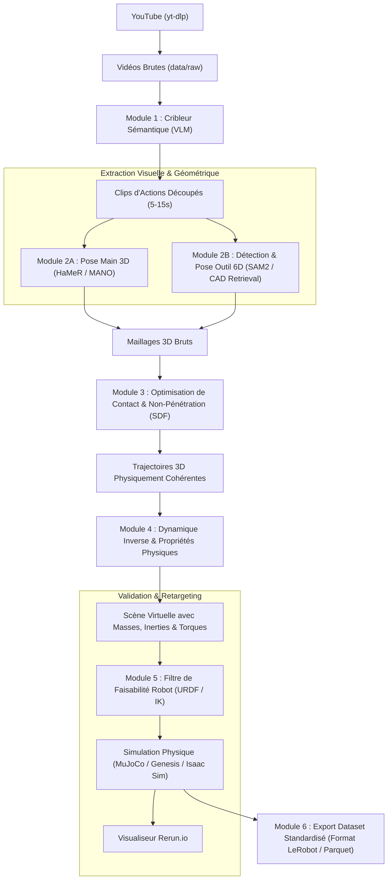

# Architecture Système : Pipeline Video-to-Physical-Digital-Twin

## 1. Vue d'Ensemble des Flux



---

## 2. Modules Détaillés

### Module 1 : Ingestion et Crible Sémantique
* **Entrée :** URL YouTube ou ID de vidéo.
* **Moteur :** `yt-dlp` pour le téléchargement 720p/1080p, couplé à une analyse par VLM (Gemini 1.5 Flash / Qwen-VL) avec échantillonnage à 1 image/sec.
* **Sortie :** Timestamps stricts `[t_start, t_end]`, verbe d'action, nom de l'objet manipulé, statut de la caméra (fixe/mobile).

### Module 2 : Extraction de Poses Conjointes
* **Main :** Modèle **HaMeR** extrayant les paramètres du modèle MANO (21 articulations + maillage de 778 sommets).
* **Objet / Outil :** Segmentation par **SAM 2** (Segment Anything 2) et appariement avec des modèles CAO canoniques (Objaverse / ShapeNet) via descripteurs d'apparence DINOv2.
* **Mire Métrique :** Utilisation de la taille connue des objets rigides (vis standard, poignée d'outil, barillet de cadenas) pour lever l'ambiguïté d'échelle métrique monoculaire.

### Module 3 : Optimisation Conjointe (Contact & Non-Pénétration)
* **Formulation :** Problème d'optimisation non linéaire sous contraintes géométriques :
  $$\min_{\theta_{\text{hand}}, T_{\text{obj}}} L_{\text{reproj}} + \lambda_1 L_{\text{SDF}} + \lambda_2 L_{\text{contact}}$$
* **Contrainte SDF :** Interdiction aux sommets de la main de pénétrer le volume intérieur du solide rigide ($\text{SDF}_{\text{obj}}(p) \ge 0$).
* **Contrainte de Contact :** Attraction locale des points de préhension sur la surface d'affordance de l'outil pendant les phases de déplacement.

### Module 4 : Dynamique Inverse & Prior Physique
* **Cinématique :** Dérivation des profils de vitesse $\dot{q}$ et d'accélération $\ddot{q}$.
* **Estimation de Masse :** Combinaison des compensations posturales (mouvements du bras/torse) et des priors sémantiques (base de connaissances de masse moyenne).

### Module 5 : Filtre de Faisabilité URDF
* **Cinématique Inverse (IK) :** Résolution par solveurs numériques (`Pinocchio` / `PyBullet`).
* **Vérification :** Butées angulaires, limites de vitesse articulaire, singularités mécaniques.
* **Score de Rejet Automatique :** Si le geste est physiquement impossible pour le modèle du robot humanoïde ou de la pince cible, la séquence est éliminée du dataset final.

### Module 6 : Packaging & Standardisation
* **Format cible :** Schéma **LeRobot** (Parquet / Arrow / HDF5).
* Métadonnées complètes : trajectoire 6D de l'effecteur/outil, pose des doigts, bounding boxes 3D, états pré/post-conditions, score de confiance.

---

## 3. Schéma de Stockage et Répertoires

```
Pose/
├── data/
│   ├── raw/              # Vidéos YouTube brutes téléchargées
│   ├── clips/            # Segments découpés de 5 à 15 secondes
│   └── processed/        # Trajectoires 3D, meshes et datasets LeRobot
├── doc/
│   ├── agents.md         # Rôles et responsabilités des agents IA
│   ├── objectifs.md      # Vision, métriques et KPIs
│   ├── roadmap.md        # Jalons et étapes d'implémentation
│   └── architecture.md   # Spécifications techniques et flux de données
├── models/
│   ├── cad/              # Modèles 3D CAO standards d'outils et objets
│   └── urdf/             # Fichiers URDF des robots cibles (Aloha, H1, etc.)
├── scratch/              # Scripts de test exploratoires, spikes et PoCs locaux
├── scripts/
│   ├── gcp/              # Scripts de batch processing et déploiement cloud
│   └── setup_env.py      # Script de vérification et préparation d'environnement
└── src/
    ├── ingestion/        # Téléchargement et découpage temporel
    ├── pose_extraction/  # Inférence HaMeR et SAM 2
    ├── physics_sanitizer/# Optimisation SDF et résolution de contact
    ├── feasibility/      # Solveur IK et filtre de rejet URDF
    └── exporter/         # Formatage LeRobot et connecteur Rerun.io
```
