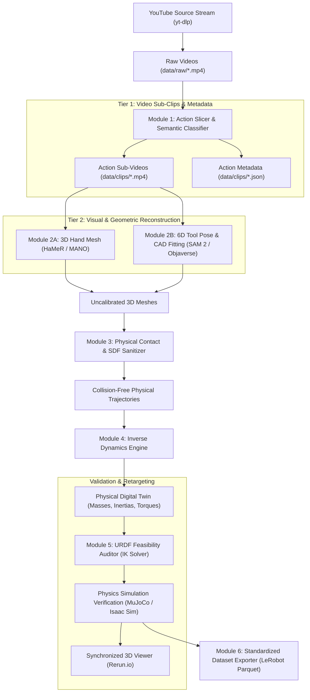

# System Architecture: Praxis Video-to-Physical-Digital-Twin

## 1. System Data Flow

---

## 2. Pipeline Subsystems

### Module 1: Action Slicer & Semantic Classifier (`src/ingestion/`)
* **Objective:** Ingest raw video and produce discrete, continuous sub-videos of physical tool manipulation, paired with structured metadata.
* **Outputs per Action Event:**
  - `data/clips/<video_id>_action_<id>.mp4` (encoded in H.264, standard 30 fps).
  - `data/clips/<video_id>_action_<id>.json` containing:
    - `t_start` and `t_end` timestamps.
    - High-level intent ("What is the person doing?").
    - Action verbs (e.g., `insert_key`, `rotate_cylinder`, `drive_screw`).
    - Tool and workpiece identities.
    - Camera motion and quality score.

### Module 2: Joint Pose & Geometry Recovery (`src/pose_extraction/`)
* **3D Hand Tracking:** Fits MANO hand parameters (21 joints, 778 vertices) per frame.
* **Tool Pose & CAD Matching:** Tracks the tool via SAM 2 masks and aligns with canonical rigid CAD primitives (cylinders, boxes, standardized fastener meshes).
* **Metric Scale Grounding:** Uses standardized dimensions of known objects (e.g., standard screws, lock cylinders) to resolve the monocular depth ambiguity.

### Module 3: Physical Contact & SDF Sanitizer (`src/physics_sanitizer/`)
* **Collision Penalty:** Computes Signed Distance Field (SDF) of the tool mesh; forces hand vertices outside the tool volume ($\text{SDF}(v) \ge 0$).
* **Contact Manifold:** Enforces fingertip attachment to the affordance surface during active tool motion.

### Module 4: Inverse Dynamics Engine (`src/dynamics/`)
* **Kinematics Derivation:** Computes velocities $\dot{q}$ and accelerations $\ddot{q}$.
* **Mass & Force Estimation:** Combines body posture lean, jerk profiles, and semantic priors to estimate workpiece mass and contact forces.

### Module 5: URDF Feasibility Auditor (`src/feasibility/`)
* **Numerical Inverse Kinematics:** Resolves target robot joint configurations using Pinocchio / PyBullet.
* **Automated Screening:** Flags mechanical singularities, velocity spikes, and joint over-extensions. Discards non-retargetable trajectories.

### Module 6: Dataset Packaging (`src/exporter/`)
* **Format:** Apache Parquet / Arrow schemas compatible with Hugging Face **LeRobot**.
* **Visual Inspection:** Synchronized logging with Rerun.io.
